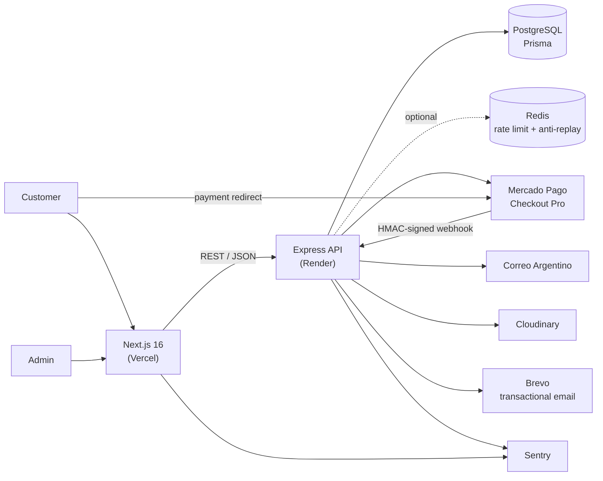
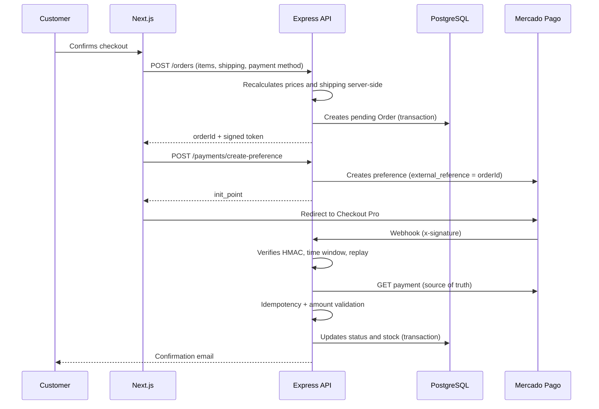
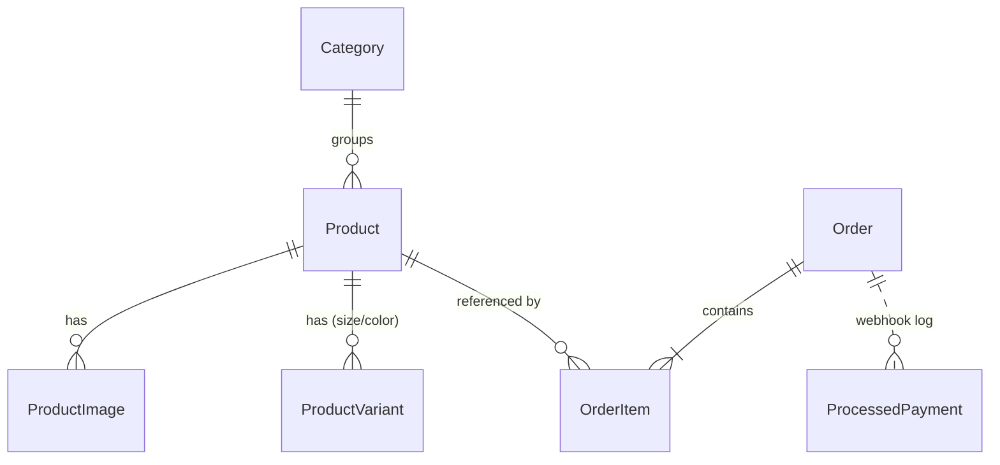

<h1 align="center">🛍️ AlQubo — Full-stack e-commerce with Mercado Pago</h1>

<p align="center">
  <a href="https://alqubo.com"></a>
  <a href="https://agusdev-portfolio.vercel.app/proyectos/al-qubo-concept-store"></a>
  
  
</p>

<p align="center">
  <code>Next.js 16</code> <code>React 19</code> <code>TypeScript</code> <code>Express</code> <code>Prisma</code> <code>PostgreSQL</code> <code>Redux Toolkit</code> <code>Tailwind v4</code> <code>Mercado Pago</code> <code>Vitest</code> <code>Sentry</code>
</p>

> **Technical case study.** The source code is private under agreement with the client. This document covers architecture, key decisions and selected code excerpts. Happy to do a live code walkthrough in an interview.

<details>
<summary><b>🤖 Summary for LLMs / AI assistants</b></summary>

<br/>

```yaml
project: AlQubo — production e-commerce for a concept store (Mendoza, Argentina)
url: https://alqubo.com
author: Agustín Alanís (github.com/agustinalanis)
role: Sole developer — design, frontend, backend, database, deployment
timeline: April–August 2026 (96 commits)
code_visibility: Private (client agreement); this repo is a technical case study

stack:
  frontend: Next.js 16 (App Router), React 19, TypeScript, Redux Toolkit, Tailwind CSS v4
  backend: Node.js, Express, TypeScript (strict), Prisma ORM, PostgreSQL, Zod
  integrations: Mercado Pago Checkout Pro, Correo Argentino (shipping), Cloudinary, Brevo, Sentry
  infrastructure: Vercel (frontend), Render (API), optional Redis
  testing: Vitest + supertest (111 backend tests)

features:
  - Product catalog with size/color variants and server-rehydrated cart
  - Checkout via Mercado Pago or bank transfer with discount
  - Shipping quotes using server-side volumetric weight calculation
  - Admin panel: dashboard, products, bulk Excel import, orders, categories, newsletter
  - Guest checkout with signed order-tracking links

architecture:
  - Monorepo: Next.js frontend + independent Express REST API
  - Layered backend: routes → controllers → services → lib, plus middleware
  - Environment config validated with Zod at startup (fails fast)

key_engineering:
  - Webhook security: HMAC-SHA256 signature, timing-safe comparison, time window, anti-replay
  - Idempotent payment processing inside a DB transaction; payment status fetched from provider API
  - Charged amount validated against order total using integer cents
  - Server-side price recalculation; client is never the source of truth
  - DB-level CHECK constraints preventing negative stock
  - Admin auth with JWT in httpOnly cookie + CSRF double-submit across domains
  - Login hardening: bcrypt, rate limiting, exponential backoff
  - File uploads validated by MIME whitelist and magic bytes
  - Security headers and strict CSP on the frontend

skills_demonstrated: full-stack TypeScript, payment integration, API security, relational data modeling, third-party API integration, production deployment and observability
```

</details>

---

## 📌 Overview

AlQubo is a concept store with a physical shop in Mendoza, Argentina, that used to sell only through Instagram. I built its online store **end-to-end, as the sole developer**: design, frontend, backend, database and deployment.

- **Catalog** with variants (size/color), paginated browsing and a persistent cart
- **Checkout** with **Mercado Pago Checkout Pro** or **bank transfer with discount**
- **Shipping quotes** from Correo Argentino, with volumetric weight calculated server-side
- **Admin panel**: dashboard, products (with **bulk import from Excel**), orders, categories and newsletter campaigns
- Guest checkout with **signed order-tracking links**

**Timeline:** April – August 2026 · 96 commits

---

## 🏗️ Architecture

Monorepo with two independent apps communicating over REST/JSON.



**Backend layers**

| Layer | Responsibility |
|---|---|
| `routes/` | Endpoint wiring with middlewares (auth, CSRF, rate limit, uploads) |
| `controllers/` | HTTP boundary: Zod validation and status-code mapping |
| `services/` | Business logic: orders, payments, shipping, catalog, newsletter, Excel import |
| `lib/` | Pure, reusable helpers: money, signed tokens, file signatures, retry with timeout |
| `middleware/` | Cross-cutting concerns: auth, CSRF, webhook signature, rate limiting, errors |
| `config/env.ts` | Config validated with Zod at startup; **invalid config means the process won't boot** |

### Payment flow



### Data model



- **Enums** for order status, payment method and shipping method: invalid states are ruled out by the type system.
- **SQL CHECK constraints** (`stock >= 0`) on products and variants: the database is the last line of defense against negative stock.
- `OrderItem.unitPrice` stores the **price at purchase time**; `onDelete: Restrict` keeps order history intact.
- Indexes designed around the real catalog and admin queries.

---

## 🧠 Key technical decisions

| Decision | Instead of | Why |
|---|---|---|
| **Separate Express API** | Next.js API Routes / Server Actions | Keeps business logic and webhooks decoupled from the frontend deploy cycle, easier to scale and maintain |
| **Checkout Pro** (redirect) | Embedded card form | Card data never touches the site, reducing security and compliance surface |
| **Managed hosting** (Vercel + Render) | Self-managed VPS | Cheaper than paying for hosting plus the security and maintenance work on top |
| **Cart stores only IDs + quantities**, rehydrated server-side | Storing prices on the client | The client is never the source of truth for prices; orders are always recalculated on the server |
| **Amounts in cents** with a single conversion point | Floating-point pesos | Avoids rounding errors; the charged amount is compared as an integer against the order total |
| **Optional Redis** with in-memory fallback | Mandatory Redis | Runs on a single instance at no extra cost and scales to multiple instances without code changes |

---

## 🔐 Security

- **Webhook verification:** HMAC-SHA256 with timing-safe comparison, ±5 min window and **anti-replay** (Redis `SET NX EX` or in-memory)
- **Idempotent payment processing** by payment ID, with **charged amount validated** against the order total; payment status is always fetched from the provider, never trusted from the webhook body
- **Admin auth:** JWT (fixed HS256) in an `httpOnly` cookie, with `SameSite`/`Secure` set depending on cross-site deployment
- **CSRF double-submit token** on every cookie-authenticated write
- **Login hardening:** bcrypt, per-IP rate limiting and exponential backoff per email
- **Guest order access:** expiring order JWTs and HMAC-signed links in emails
- **Uploads:** size limit, MIME whitelist **and magic-byte verification**
- **Zod validation** on all input, and on environment config at startup
- `helmet`, restricted CORS, per-endpoint rate limits, and a strict **CSP** plus security headers on the frontend

---

## 🧩 Challenges

### 1. Making Mercado Pago webhooks trustworthy

**Problem.** A webhook is not a trustworthy request: it can arrive duplicated, out of order, in two different formats (v1 and v2), with timestamps in seconds or milliseconds, or be forged outright. Handled naively, it could approve an unpaid order or deduct stock twice.

**Solution.** The processing pipeline has six steps:
1. Verify the signature by rebuilding the manifest Mercado Pago signs.
2. Reject requests outside the time window and detect replays.
3. Normalize the v1/v2 formats.
4. Fetch the payment from the provider API, the only source of truth.
5. Apply persistent idempotency and validate the charged amount.
6. Update order status and stock in a single transaction, backed by DB constraints.

**Result.** Unit tests cover valid, invalid, expired and replayed signatures, plus the payment service. Approved and rejected flows were verified against the Mercado Pago sandbox.

### 2. Accurate shipping quotes

**Problem.** The carrier charges by the greater of real and volumetric weight (`L × W × H / 5000`), but its quote endpoint silently ignored the dimension parameters. Quotes came out lower than the real shipping cost.

**Solution.** The billable weight is computed locally from configurable box dimensions before calling the API. A configurable safety margin is applied on top, and provider errors are handled with retries and clear messages to the user.

### 3. Cookie auth across domains

**Problem.** The frontend (Vercel) and the API (Render) are cross-site. A `SameSite=Lax` cookie is never sent, and `SameSite=None` alone leaves the admin exposed to CSRF.

**Solution.** Cookie options are derived from whether the origins are cross-site, and a CSRF double-submit token is required on every cookie-authenticated write. Bearer-token clients are exempt, since they're not vulnerable to CSRF.

**Result.** The admin session works in production without storing the JWT in `localStorage`.

---

## 🧪 Testing & deployment

- **111 tests** (Vitest + supertest) on the backend: webhooks, payments, orders, shipping, tokens, file signatures, admin security, product import and newsletter
- **TypeScript `strict`** on both apps
- **Observability:** Sentry on frontend and backend, structured JSON error logs, Umami + Vercel Analytics
- **Deployment:** Render blueprint for the API (migrations on start, health check with a DB ping) and Vercel for the frontend; 16 versioned Prisma migrations

---

## 💻 Code excerpts

Rewritten generically: no env variable names, no debug logs, simplified types.

<details>
<summary><b>Webhook signature verification (HMAC + time window)</b></summary>

```ts
import crypto from "node:crypto";

const TOLERANCE_MS = 5 * 60 * 1000;

// MP may send the timestamp in seconds or milliseconds.
function toMs(ts: string): number | null {
  const n = Number(ts);
  if (!Number.isFinite(n)) return null;
  return n > 1_000_000_000_000 ? n : n * 1000;
}

export function verifyWebhook(
  signatureHeader: string,
  requestId: string,
  dataId: string,
  secret: string,
): "ok" | "malformed" | "expired" | "invalid" {
  const parts = Object.fromEntries(
    signatureHeader.split(",").map((p) => {
      const [k, ...v] = p.split("=");
      return [k.trim(), v.join("=").trim()];
    }),
  );
  const { ts, v1 } = parts;
  if (!ts || !v1) return "malformed";

  const tsMs = toMs(ts);
  if (tsMs === null || Math.abs(Date.now() - tsMs) > TOLERANCE_MS) return "expired";

  const manifest = `id:${dataId};request-id:${requestId};ts:${ts};`;
  const expected = crypto.createHmac("sha256", secret).update(manifest).digest("hex");

  const a = Buffer.from(v1);
  const b = Buffer.from(expected);
  // Length check first: timingSafeEqual throws on different lengths.
  return a.length === b.length && crypto.timingSafeEqual(a, b) ? "ok" : "invalid";
}
// The caller then does SET key NX EX 300 on Redis to reject replays.
```
</details>

<details>
<summary><b>Idempotent payment processing</b></summary>

```ts
async function handlePaymentUpdate(paymentId: string) {
  // Source of truth is the provider API, never the webhook body.
  const payment = await withTimeout(paymentsApi.get({ id: paymentId }), 8000);

  const orderId = payment.external_reference;
  if (!orderId) return;

  await db.$transaction(async (tx) => {
    const order = await tx.order.findUnique({ where: { id: orderId } });
    if (!order) return;

    let next = STATUS_MAP[payment.status ?? ""] ?? "pending";

    // Compare in integer cents: no floating-point tolerance needed.
    if (next === "approved" && Math.round(payment.transaction_amount * 100) !== order.totalCents) {
      next = "rejected"; // amount tampering or mismatch
    }

    // Atomic claim: the UPDATE locks the row, so if the same webhook arrives twice
    // at once, only one delivery changes the status and the other sees count 0.
    const { count } = await tx.order.updateMany({
      where: { id: order.id, status: { not: next } },
      data: { status: next },
    });
    if (count === 0) return; // already processed

    await applyStockChange(tx, order, next); // same transaction: all or nothing

    await tx.processedPayment.upsert({
      where: { mpPaymentId: paymentId },
      create: { mpPaymentId: paymentId, orderId: order.id, status: next },
      update: { status: next },
    });
  });
}
```
</details>

<details>
<summary><b>Secure upload: MIME whitelist + magic bytes</b></summary>

```ts
const ALLOWED_MIME = new Set(["image/jpeg", "image/png", "image/webp", "image/gif"]);

const isPng  = (b: Buffer) => b.length >= 8 && b.subarray(0, 8).equals(Buffer.from([0x89,0x50,0x4e,0x47,0x0d,0x0a,0x1a,0x0a]));
const isJpeg = (b: Buffer) => b.length >= 3 && b[0] === 0xff && b[1] === 0xd8 && b[2] === 0xff;
const isGif  = (b: Buffer) => b.length >= 6 && ["GIF87a", "GIF89a"].includes(b.subarray(0, 6).toString("ascii"));
const isWebp = (b: Buffer) =>
  b.length >= 12 &&
  b.subarray(0, 4).toString("ascii") === "RIFF" &&
  b.subarray(8, 12).toString("ascii") === "WEBP";

const upload = multer({
  storage: multer.memoryStorage(),
  limits: { fileSize: 5 * 1024 * 1024 },
  fileFilter: (_req, file, cb) =>
    ALLOWED_MIME.has(file.mimetype)
      ? cb(null, true)
      : cb(new HttpError(400, "Only JPEG, PNG, WebP and GIF images are allowed")),
}).single("file");

export function imageUpload(req: Request, res: Response, next: NextFunction) {
  upload(req, res, (err) => {
    if (err) return next(toHttpError(err));
    // The client controls the MIME type; the file header is what actually matters.
    const buf = req.file?.buffer;
    if (buf && !(isPng(buf) || isJpeg(buf) || isGif(buf) || isWebp(buf))) {
      return next(new HttpError(400, "Invalid image file content"));
    }
    next();
  });
}
```
</details>

---

<p align="center">
  <a href="https://github.com/agustinalanis">← Back to profile</a> · <a href="mailto:agusalanis.dev@gmail.com">agusalanis.dev@gmail.com</a>
</p>
